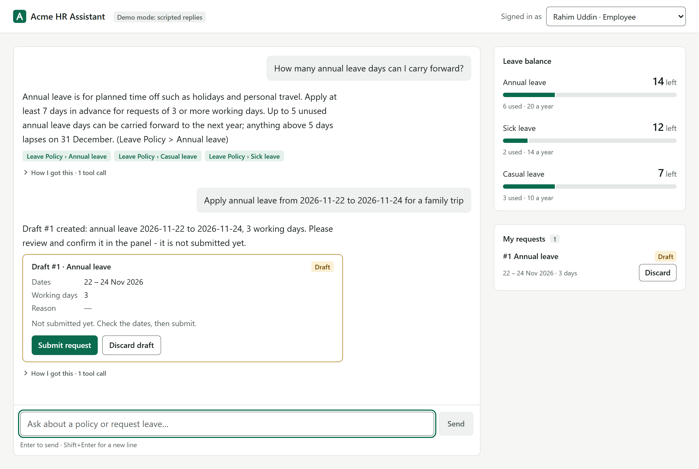
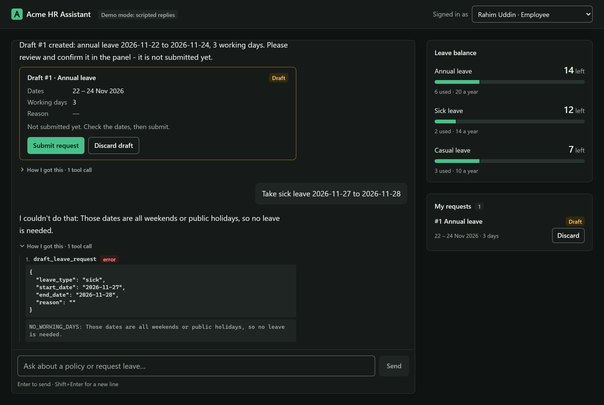
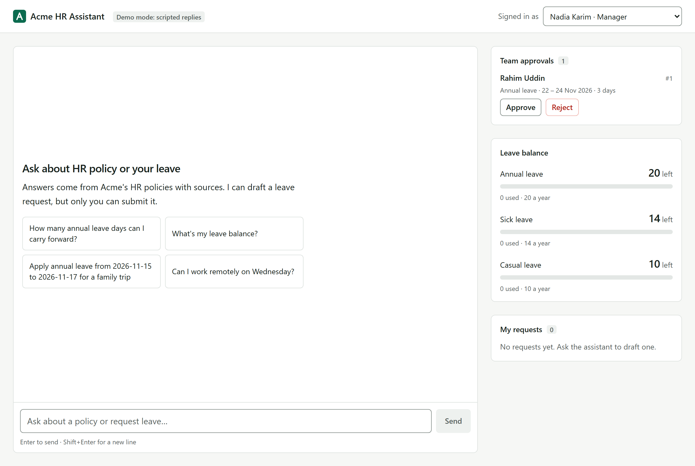
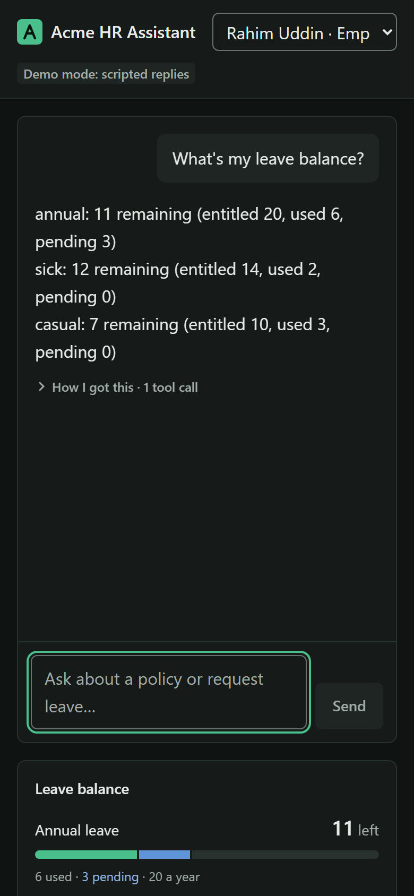
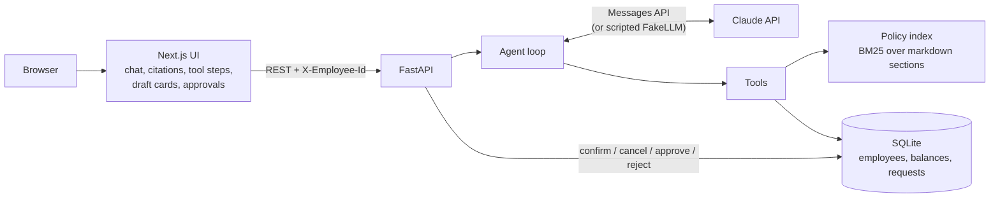

# Acme HR Assistant

An HR policy assistant and leave agent: employees ask policy questions and get cited answers, then ask the agent to draft leave requests. The employee confirms each draft, and their manager approves or rejects it.

> **Portfolio / demo project.** "Acme Corp", its employees and its policies are fictional. It is not used in production and has no real users.



## Screenshots

| Tool trace when a request fails (dark mode) | Manager approvals |
|---|---|
|  |  |

<p align="center"></p>

## Demo conversation

Real replies from the app in **demo mode** (the scripted `FakeLLM`, no API key), signed in as the employee Rahim Uddin with today's date set to 3 Nov 2026. The demo model returns tool output almost verbatim; with an API key, Claude calls the same tools and writes the answer in its own words.

| You ask | Tool the agent calls | Reply |
|---|---|---|
| How many annual leave days can I carry forward? | `search_policy` | "…Up to 5 unused annual leave days can be carried forward to the next year; anything above 5 days lapses on 31 December. *(Leave Policy > Annual leave)*" + citation chips |
| What's my leave balance? | `get_leave_balance` | "annual: 14 remaining (entitled 20, used 6, pending 0) · sick: 12 remaining · casual: 7 remaining" |
| Can I work remotely on Wednesday? | `search_policy` | "Eligible employees may work remotely up to 2 days per week… Wednesday is a team day when everyone works from the office. *(Remote Work Policy > Remote days per week)*" |
| Apply annual leave from 2026-11-22 to 2026-11-24 for a family trip | `draft_leave_request` | "Draft #1 created: annual leave 2026-11-22 to 2026-11-24, 3 working days. Please review and confirm it in the panel - it is not submitted yet." + a draft card with **Submit request** / **Discard draft** |
| Take sick leave 2026-11-27 to 2026-11-28 | `draft_leave_request` → error | "I couldn't do that: Those dates are all weekends or public holidays, so no leave is needed." (27–28 Nov 2026 is a Friday and Saturday) |
| What's the policy on quantum spaceships? | `search_policy` → no match | "I couldn't find that in Acme's HR policies. For anything they don't cover, please contact HR at hr@acme.example." |

Then switch the user to **Nadia Karim (Manager)**: the submitted request appears under *Team approvals*, and after **Approve** Rahim's request shows as *Approved* and his balance moves the days from pending to used.

## What it does

- **Answers HR policy questions** from three markdown policies (leave, remote work, expenses and travel) and cites the section it used, e.g. *(Leave Policy > Annual leave)*. If the policies don't cover a question, it says so instead of guessing.
- **Knows the signed-in employee's data**: leave balance, their own requests, working-day counts (Friday–Saturday weekend plus public holidays).
- **Drafts leave requests** from plain language ("annual leave next Sunday to Thursday"), after checking dates, overlaps, casual-leave limits and balance.
- **Keeps a human in the loop**: the model can only create a *draft*. The employee confirms it in the UI, and the manager approves or rejects it on an approvals screen.
- **Shows its work**: the UI lists each tool call the agent made, the citations it used and draft cards with confirm buttons.
- **Runs without an API key**: a scripted `FakeLLM` drives the same tool loop, so the demo and the tests cost nothing.

## Architecture



The frontend calls the backend directly from the browser. The REST endpoints for confirm, cancel and approve skip the agent: only a person clicking in the UI can move a request past the draft stage.

## How the agent works

The loop is in [`backend/app/agent.py`](backend/app/agent.py), about 40 lines, with no framework:

1. Append the user's message to the conversation history.
2. Call the model with the system prompt (today's date and who the employee is), the history and the tool definitions.
3. Append the model's full response to the history, thinking blocks included.
4. If the model refused, return a safe fixed reply. If it asked for no tools, return its text: that is the answer.
5. Otherwise run every requested tool and send all the results back in **one** user message. A failed tool returns `is_error: true` with a readable code (e.g. `OVERLAP`, `INSUFFICIENT_BALANCE`) so the model can explain the problem or fix its input.
6. Repeat from step 2, up to `HR_AGENT_MAX_STEPS` (default 6), then stop with a "please split your question" reply.

### Tools

| Tool | What it does | Side effect |
|---|---|---|
| `search_policy` | BM25 search over policy sections; returns text plus document/section for citations | None (read-only) |
| `get_leave_balance` | Entitled / used / pending / remaining days per leave type | None (read-only) |
| `list_my_leave_requests` | The employee's requests, optionally filtered by status | None (read-only) |
| `count_working_days` | Working days between two dates (weekend and holidays excluded) | None (pure function) |
| `draft_leave_request` | Validates and creates a leave request in `draft` status | Creates a **draft** only; balance is not touched until a human confirms |

All tool schemas use `strict: true` with `additionalProperties: false`, so the model's inputs always match the schema.

### Safety design

- **IDOR-safe tools**: no tool takes an employee id. The id comes from the server-side `ToolContext` of the authenticated request, so a prompt cannot make the agent read or change another person's data. Someone else's request returns the same `NOT_FOUND` error as a request that doesn't exist.
- **Human in the loop**: the model can only draft. Confirming is an employee action and approving is a manager action, both done through REST endpoints the model cannot call.
- **Race-safe state changes**: every status change and balance change is a conditional `UPDATE ... WHERE status = 'pending'` / `WHERE remaining >= days`, checked by row count. Double-confirming, double-approving or overdrawing a balance fails cleanly, and a failed confirm rolls back fully.
- **Private conversations**: a conversation id belongs to the employee who started it; anyone else gets a 404.
- **Append-only history**: assistant turns go back to the model unchanged (thinking blocks included), which keeps thinking-block replay and prompt caching valid.
- **Bounded loop**: a step limit stops runaway tool loops; `max_tokens` cut-offs are flagged in the reply.
- **Refusals handled**: a `refusal` stop reason returns a fixed, polite reply that points to HR. API rate limits and outages map to 429 / 503 with readable messages.
- **Grounded answers**: the system prompt requires policy answers to come from `search_policy` results with a citation, and an answer that points to hr@acme.example when the policies don't cover the question.

## Run it

Requirements: Python 3.13, Node.js 24. The steps below use a POSIX shell; on Windows use `.venv\Scripts\activate`.

### Without an API key (scripted demo model)

```bash
# backend - http://localhost:8000 (API docs at /docs)
cd backend
python -m venv .venv && source .venv/bin/activate
pip install -r requirements.txt
uvicorn app.main:app --reload

# frontend - http://localhost:3000 (in a second terminal)
cd frontend
npm install
npm run dev
```

With no `ANTHROPIC_API_KEY` set, the backend uses `FakeLLM`, a keyword router that calls the same tools and returns their results. `GET /api/health` shows which model client is active. The SQLite database (`backend/hr.db`) is created and seeded on first start with one manager (Nadia, `M001`) and two employees (Rahim `E001`, Sadia `E002`).

### With Claude

```bash
cp .env.example .env         # then set ANTHROPIC_API_KEY in .env
cd backend
uvicorn app.main:app --reload --env-file ../.env
```

The model defaults to `claude-opus-5-5` at `medium` effort. Every setting is documented in [`.env.example`](.env.example). The frontend reads `NEXT_PUBLIC_API_URL` (default `http://localhost:8000`) from its own environment or `frontend/.env.local`. Set `HR_TODAY=2026-11-03` to pin today's date for reproducible demos.

### Docker Compose

```bash
cp .env.example .env         # optional: add ANTHROPIC_API_KEY
docker compose up --build    # frontend :3000, backend :8000
```

The SQLite file lives in the `hr-data` named volume at `/data/hr.db`, and the backend container runs as a non-root user. `NEXT_PUBLIC_API_URL` is passed as a **build arg** because Next.js inlines it into the client bundle at build time, so changing it means rebuilding the frontend image.

## Tests

```bash
cd backend && pytest        # 35 tests, run on FakeLLM and in-memory SQLite, no network
```

| File | What it covers |
|---|---|
| `tests/test_leave.py` (14) | Working-day maths (weekend, holidays); drafts don't touch the balance; validation errors (past date, bad range, weekend-only, cross-year, casual > 3 days, unknown type); insufficient balance; overlapping requests; full confirm → approve lifecycle with double-confirm and double-decide rejected; reject and cancel release days; confirm rechecks balance and rolls back; nobody can confirm, cancel or decide another person's request |
| `tests/test_tools_and_agent.py` (11) | Policy search ranks the right section and returns nothing for nonsense; all tool schemas are strict; tools act only as the signed-in employee; draft tool never submits; bad tool input becomes an error result, not an exception; agent answers with citations and the expected message sequence; agent drafts but doesn't submit; tool errors reach the model with `is_error`; the step limit stops a model that loops forever; refusals are handled; the demo model never shows tool instructions to the user |
| `tests/test_api.py` (4) | Missing or unknown employee header is rejected; end-to-end chat → draft → confirm → manager approve, with other users blocked at each step; conversations are private to their owner; repeated confirm returns a readable 409 |
| `tests/test_regressions.py` (6) | One test per bug found in code review: leave can be planned into next year; overlapping drafts can't both be confirmed; a crashing tool still produces a `tool_result`; an empty refusal is not written into history; a failed balance update rolls back the whole cancel; a second turn on a busy conversation gets 409 |

CI ([`.github/workflows/ci.yml`](.github/workflows/ci.yml)) runs the backend tests and the frontend lint and build on every push to `main` and on pull requests.

## Design decisions & trade-offs

- **BM25 instead of embeddings.** Three short policies split into about a dozen sections: keyword ranking finds the right one, needs no embedding model or vector store, and is deterministic in tests. It struggles with paraphrased questions, so a larger policy library would need embeddings (see below).
- **Hand-written loop instead of an agent framework.** The loop is about 40 lines, so every step is visible and testable. Fake models plug in to test the step limit and refusals, and history handling (parallel tool results in one message, thinking-block replay) is explicit rather than hidden in a library.
- **In-memory conversations.** Chat history lives in the API process: it is lost on restart and can't be shared across replicas. This is a known limitation, marked in `main.py`, and acceptable for a single-instance demo.
- **SQLite.** No setup, one file, and the in-memory mode makes tests fast. Balance changes are conditional `UPDATE`s and don't depend on SQLite, so moving to Postgres is a connection-string change.
- **Demo auth header instead of real auth.** The UI sends `X-Employee-Id` for a seeded user so reviewers can switch between employee and manager. The server still checks that the employee exists and passes the id to tools itself. Real deployments need SSO/JWT here.
- **Claude Opus 5.5 at `medium` effort with the server-side fallback.** Medium effort gives enough reasoning for date handling and multi-tool turns without the latency of higher settings. If a request is declined, the server-side fallback (`server-side-fallback-2026-07-01` beta) retries it on another model within the same API call, and the app still handles a final `refusal` itself.

## What I'd add next

- Real authentication (SSO / OIDC) with roles taken from the identity provider
- Streaming responses so tool steps and text appear as they happen
- Embeddings with pgvector for paraphrased questions and a larger policy library
- Persistent conversations (database or Redis) for restarts and multiple replicas
- Evals built from real (anonymised) transcripts: citation accuracy, correct dates, no unwanted drafts
- Bengali language support for questions and answers
- An audit log of every tool call and every approval decision

## Tech stack

- **Backend:** Python 3.13, FastAPI, SQLModel / SQLAlchemy, SQLite, rank-bm25, Anthropic Python SDK, pytest
- **Frontend:** Next.js 16, React 19, TypeScript, Tailwind CSS 4
- **Model:** Claude Opus 5.5 (`claude-opus-5-5`), or the scripted `FakeLLM` without a key
- **Tooling:** Docker / Docker Compose, GitHub Actions

## License

[MIT](LICENSE) © 2026 Shah Ul Jasun
